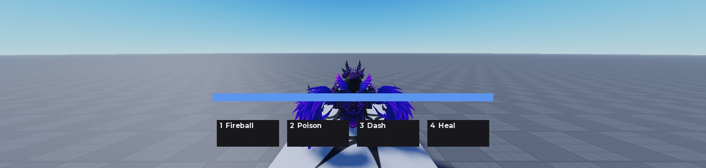

# ability-kit — data-driven ability framework for Roblox

**Date:** 2026-10-13
**Role:** Systems developer & author
**Tech:** Luau, Rojo, selene, stylua · MIT
**Status:** Completed · published (closed 2026-10-14)
**Repo:** [github.com/jetoxp/ability-kit](https://github.com/jetoxp/ability-kit)

---

## What it is

A framework for building abilities in Roblox where **abilities are data, not code** — id, cost,
cooldown, cast time, targeting and effects, all declared in a table and validated at load. There is no
`if id == "FIREBALL"` anywhere in the codebase.

The design constraint that shaped everything else: **the logic that decides is pure Luau that runs in a
terminal**, and the contact with the engine is confined to two thin files. Most Roblox systems put the
decision and the engine call in the same function, which means the only way to test a cooldown is to
open Studio.

## Measured

Every number below is reproducible from the repository.

| Measure | Value |
|---|---|
| Test cases, run with `luau tests/run.luau` | **225** across **8 suites** |
| Of those, testable without an engine | **All of them**, in a few seconds |
| Source + test lines | **6,333** |
| Modules that touch the engine | **2** (`EffectAdapter`, `TargetAdapter`) |
| Abilities shipped as sample data | **4** (Fireball, Poison, Dash, Heal) |
| `selene` / `stylua` | 0 errors, 0 warnings / clean |
| CI | GitHub Actions, pinned to the same tool versions: tests, lint and format on every push |

Not measured: real concurrent players. This is a framework, not a game, and it has never carried a live
population.

## What it does

- **Abilities as validated data** — a definition that contradicts itself is refused at load, with
  warnings that name the field you probably meant.
- **Per-ability state machine** — `idle`, `casting`, `active` (an instant, not a duration), `cooldown`.
  Effects fire exactly once per activation.
- **Loadouts and cooldowns keyed by slot** — so the same ability can sit on two slots without the
  cooldowns collapsing into one.
- **Resource pools with regeneration**, with an all-or-nothing spend that names the pool that stopped it.
- **Instant and timed effects** — damage, dot, heal, buff, debuff, dash, with a stacking policy declared
  per effect.
- **Server-side targeting** — `self` and `raycast`, with the caster excluded from direct targets, dead
  candidates discarded, and a radius that catches everyone near the impact point.
- **One wire, one shape** — the client sends `{ action = "activate", slot = N }` and nothing else; a
  payload carrying an extra field is refused, because "it only reads `slot`" stops being true the moment
  somebody adds a convenient field.

*The HUD, drawn from the snapshot by `HudPresenter` — a pure module with its own suite. The numbers on
screen are decided by code that runs in a terminal; the renderer only assigns values to properties.*

## How it is verified

The interesting part of this project is not the suite. **Eight test suites cover everything that decides, and they could not see the bugs that
mattered.** Every one of those lived in the seam where the
pure logic meets the engine, and every one was found by running the thing:

| Where | What it was |
|---|---|
| definition → catalog | a container replaced by name, taking a neighbouring loop with it |
| module → module | a function declared with a dot called with a colon, so an adapter arrived where a character was expected |
| pure → engine | the adapter was supposed to convert a `Vector3` into `{ x, y, z }`; none did, and every candidate was silently rejected |
| design → engine | a shot that hit nothing selected its own caster and dealt it 44 damage |
| engine → tick | a `Heartbeat` callback that threw was disconnected by Roblox: the game spent mana and never fired again |
| probe → place | five playtests diagnosing a bug that was not in the code: the project was being re-synced while the playtests ran, so the script under test and the probe were always one generation apart |

So the verification is behavioural, observed in a live playtest rather than asserted in a test:

- a single-target ability damages **another** character at distance, and the caster's health does not
  change;
- a miss **spends mana, produces zero events, and writes zero lines to the Output**;
- a miss leaves the caster at full health;
- an activation spends the cost at the activation, so an interrupted cast is a paid cast;
- a second activation is refused by the cooldown without charging again, and the refusal **names
  itself and its reason**: `[ability-kit] Jetoxsaurio asked for slot 1 and was refused: alreadyCasting`
  and `... slot 3 ... abilityOnCooldown` — two slots, two reasons, one run;
- death restores the pools, clears the cooldowns, and drops the effects attached to the character;
- the HUD draws the four slots with their keybinds, its mana bar reads `0.82` against a snapshot of
  `82.74`, and activating moves the screen: the bar falls, a cast bar fills and disappears, and the
  slot refills with its cooldown.

## Known limitations

Declared, not discovered:

- The HUD shows but does not configure: no rebindable keys, no effect icons, no damage numbers.
- The HUD interpolates between the last two snapshots and therefore lags up to one tick behind — never
  ahead, which is the asymmetry that makes it verifiable.
- Targeting does not accept client-supplied references; only the server's raycast.
- NPCs work as targets by construction and are untested.
- A dash is a single displacement, not motion over time.
- Only `speed` is translated for buffs and debuffs.
- A miss in a hybrid ability (damage + heal) still heals its caster.
- The two engine adapters have no suite and cannot have one — that is the price of the other modules
  having one.

## What it demonstrates

- **Testability as an architectural constraint**, not an afterthought: no module `require`s another,
  config and catalog are injected, and the adapters are deliberately stupid. The suite runs with no
  Roblox at all.
- **Validation as a design tool**: the definitions refuse the combinations that contradict the model at
  load, so a mistake costs a load error instead of a mysterious behaviour.
- **Knowing where the bugs are.** The five above are all boundary failures, and the case study says so
  rather than presenting a green suite as proof of correctness.
- **Verification on the engine**, with the discipline of quoting an observed run instead of an intended
  behaviour.
- **Knowing when the bug is not in the product.** The HUD phase spent five playtests and four diagnostic
  instruments on a component that was correct from the commit that wrote it: the project was being
  edited and re-synced while the playtests ran, so the script under test and the probe reading it were
  always one generation apart. The bug was in the measurement environment, and it was found by the same
  discipline that finds the ones in the code — with the extra honesty of writing down that the phase's
  own prediction had been wrong.

## Links

- Repository: https://github.com/jetoxp/ability-kit
- Phase notes, in order, in the repository under `docs/phases/` (`PHASE_1.md` … `PHASE_7.md`): the log,
  including every bug and the correction it forced. `PHASE_7.md` is worth reading for the closing
  lesson alone — a phase that spent five playtests debugging its own measurement setup, and says so.
